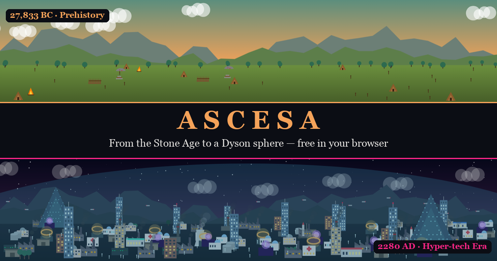
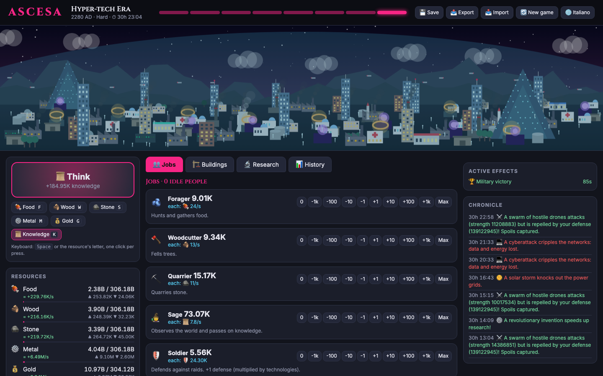

<div align="center">

# 🔥 Ascesa — from stone to the stars

**Lead a tribe from the Stone Age to a Dyson sphere.**
A free civilization clicker/idle game that runs in your browser: no install, no account, no ads.

### [▶ Play now](https://andrearufo.github.io/ascesa/)



   

</div>

## Why you'll lose an evening to it

- **8 eras, 102 technologies, 62 buildings, 14 jobs.** Hunters and sages become farmers, workers, scientists, AI technicians and quantum engineers.
- **8 irreversible choices** shape your run: tribe, government, economy, labor, energy, ideology, your stance on AI, and your destiny.
- **Civilizations can fall.** Famine, revolts, raids, the Black Death, the Great War, the missile crisis, climate collapse, a rogue AI and an incoming asteroid can each end your game.
- **Three ways to win:** build a *Dyson sphere*, launch a *Star Ark*, or upload everyone in a *Digital Ascension*.
- **33 random events**, 9 of them with tough choices: refugees at the gates, heresy, general strikes, an AI breakthrough you may not be ready for…
- **A living scene:** the landscape grows from tents and campfires to arcologies and spaceports, with day and night, smog, snow and blackouts.
- **Long-term progression:** legacy points carry over between runs, plus 29 achievements, 3 difficulty levels and up to 4 hours of offline progress.



## How to play

1. **Click** (or press `Space`, or the resource's letter) to gather. Holding a key doesn't count: every press is a click.
2. **Assign jobs** to your people. Keep food positive, or they starve.
3. **Build** housing, storage, workshops, power plants and labs. Storage caps limit what you can afford, so plan ahead.
4. **Research** technologies. Each one takes time, and you can queue several (paid up front).
5. **Survive.** Watch stability, defense, pollution and AI risk, and pay off timed crises before they hit.
6. **Win** by completing one of the three megaprojects of the last era.

Your game saves automatically in the browser. Use 📤 Export to move it to another device.

## Under the hood

Under 2,500 lines of plain JavaScript modules. No framework, no bundler, no npm packages.

```
index.html, style.css
js/data.js     game data: resources, jobs, buildings, technologies, achievements
js/engine.js   DOM-free engine: economy, population, stability, saving
js/events.js   events, raids, crises, endings
js/scene.js    animated canvas scene
js/ui.js       interface
js/i18n.js     t`text` translates the Italian source text through js/en.js
test/sim.js    data checks + a greedy bot that plays whole games to test the balance
test/i18n.js   makes sure every text has an English translation
```

The engine never touches the DOM, so a bot can play thousands of simulated hours in node to check the balance:

```bash
node test/sim.js 4 normal
```

On Normal the bot wins in about 5–9 hours of game time.

To run it locally, serve the folder with any static server, for example `python3 -m http.server`, and open it in a browser.

## Feedback

Found a bug, a broken strategy or a balance issue? [Open an issue](https://github.com/andrearufo/ascesa/issues), ideally with your save code from 📤 Export.
If you enjoyed it, a ⭐ helps other people find the game.

---

<details>
<summary>🇮🇹 In italiano</summary>

**Ascesa** è un gioco di civiltà clicker/idle, gratuito, che gira nel browser: guidi una tribù dalla preistoria fino a un futuro iper-tecnologico.
La lingua segue quella del browser e si cambia con il pulsante 🌐 in alto.

- **Clicca** (o premi `Spazio`, o `C` cibo, `L` legno, `P` pietra, `M` metallo, `O` oro, `K` conoscenza) per raccogliere.
- **Assegna i lavori**, **costruisci**, **ricerca** oltre 100 tecnologie in 8 ere, con 8 scelte esclusive.
- **Sopravvivi** a carestie, rivolte, razzie, epidemie, guerre, inquinamento, IA ribelli e asteroidi.
- **Vinci** completando la Sfera di Dyson, l'Arca Stellare o l'Ascensione Digitale.

**Gioca:** https://andrearufo.github.io/ascesa/

</details>
